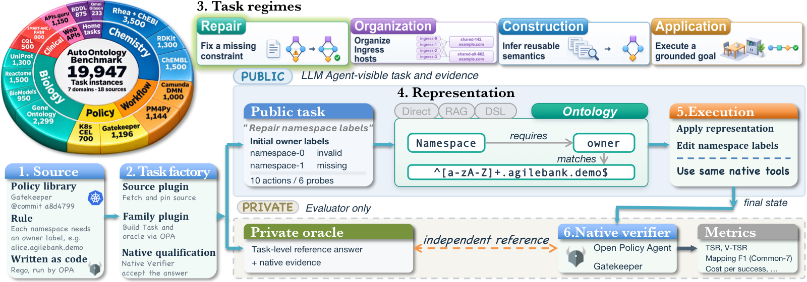

<h1> AutoOntologyBench</h1>

[](https://arxiv.org/abs/2611.27734)
[](https://huggingface.co/datasets/Vinyeh/AutoOntologyBench/)
[](LICENSE)

**AutoOntologyBench** is a task-grounded benchmark for **agentic knowledge
engineering**. It asks whether foundation-model agents can acquire, organize,
repair, and construct domain knowledge, and whether the resulting ontologies
improve *verified* task success over direct tool use or retrieval.

Follow the [AutoOntologyBench community](https://huggingface.co/AutoOntologyBench)  for releases and discussion.

<p align="center">
  
</p>

The benchmark is grounded in **18 real-world, versioned knowledge sources**
across **7 domains** and **16 native-verifiable lanes**, each scored by its
source-native verifier. Tasks span four regimes: **Application**, **Repair**,
**Organization**, and **Construction**. The released Answer-20K set contains
**19,947 audited tasks** derived from 4,511 base goals and 325 task families;
the Core-track public package contains **19,950 world-grounded task records**
across L01–L16.

| Track | Scope | Tasks | Entry point |
|---|---|---:|---|
| Answer-20K | answer-only evaluation over the 20K task set | 19,947 | `src/scripts/eval_20k_all.sh` |
| Core-track | world-grounded W3C ontology tasks with per-world/lane/split scoring | 19,950 | `src/scripts/eval_core.sh` |

The public data is downloaded from HuggingFace. The private oracles are mounted
separately and must never be published. Research/experiment code, labels, run
artifacts, and oracle payloads are not part of this repository.

## World lanes and sources

Each lane pairs one or two pinned source snapshots with a public task interface
and a native verifier. The 16 lanes cover 18 sources across seven domains:

| Lane | Domain | Pinned source(s) |
|---|---|---|
| L01 | Policy | [Gatekeeper library](https://github.com/open-policy-agent/gatekeeper-library) |
| L02 | Policy | [Kubernetes CEL](https://kubernetes.io/docs/reference/using-api/cel/) |
| L03 | Workflow | [Camunda DMN examples](https://github.com/camunda/camunda-bpm-examples/tree/master/dmn-engine/dmn-engine-java-main-method) · [DMN TCK](https://dmn-tck.github.io/tck/) |
| L04 | Chemistry | [Rhea](https://www.rhea-db.org/help/download) · [ChEBI](https://www.ebi.ac.uk/chebi/downloads) |
| L05 | Chemistry | [RDKit functional-group hierarchy](https://github.com/rdkit/rdkit/blob/master/Data/Functional_Group_Hierarchy.txt) |
| L06 | Biology | [Gene Ontology](https://geneontology.org/docs/download-ontology/) |
| L07 | Biology | [BioModels](https://www.ebi.ac.uk/biomodels/) |
| L08 | Clinical | [Clinical Quality Language](https://github.com/cqframework/clinical_quality_language) |
| L09 | Clinical | [World Health Organization (WHO) SMART Antenatal Care (SMART-ANC)](https://github.com/WorldHealthOrganization/smart-anc) |
| L10 | Home tasks | [BEHAVIOR-1K BDDL](https://github.com/StanfordVL/BEHAVIOR-1K/blob/main/docs/behavior_components/behavior_tasks.md) |
| L11 | Home tasks | [OmniGibson](https://github.com/StanfordVL/OmniGibson) |
| L12 | Workflow | [PM4Py](https://github.com/process-intelligence-solutions/pm4py) |
| L13 | Web APIs | [APIs.guru OpenAPI directory](https://github.com/APIs-guru/openapi-directory) |
| L14 | Chemistry | [ChEMBL](https://www.ebi.ac.uk/chembl/) |
| L15 | Biology | [Reactome](https://reactome.org/) |
| L16 | Biology | [UniProt](https://www.uniprot.org/) |

Links point to the upstream projects; each benchmark release pins a specific
commit or release recorded in the dataset manifest.

## Repository layout

```text
AutoOntologyBench/
├── src/
│   ├── autoontobench/          # shared model/API types and task-generation code
│   ├── benchmark/
│   │   ├── eval_20k/           # Answer-20K evaluator and tests
│   │   ├── eval_core/          # Core-track evaluator
│   │   ├── plugins/            # lane source, task-family and verifier plugins
│   │   ├── schema/
│   │   └── expansion/
│   ├── scripts/
│   │   ├── eval_20k_all.sh     # canonical Answer-20K launcher
│   │   ├── eval.sh             # historical launcher, still supported
│   │   ├── eval_from_hf.sh     # download Answer-20K data, then evaluate
│   │   ├── eval_core.sh        # Core-track launcher
│   │   ├── eval_core_from_hf.sh
│   │   └── core_release/       # Core release assembly and verification
│   └── LICENSES/               # third-party source attribution
├── extras/                     # Core construction examples
├── docs/CORE.md                # Core-track details and submission contract
├── ACADEMIC_USE.md
├── README.md
├── LICENSE
└── requirements.txt
```

The internal Python package path `benchmark.eval_20k` is a historical module
name and is unchanged for compatibility.

## Install

```bash
python3.11 -m venv .venv
. .venv/bin/activate
pip install -r requirements.txt
```

## Pull the public data

```bash
export HF_TOKEN="..."
pip install -U huggingface_hub
hf download Vinyeh/AutoOntologyBench \
  --repo-type dataset \
  --local-dir ../aob-data
```

Expected paths:

```text
../aob-data/tasks/qualified_tasks_test.jsonl                       # Answer-20K
../aob-data/core_worlds/data/core/tasks/tasks.jsonl                # Core-track
```

If your snapshot uses the standalone Core dataset repository, download
`Vinyeh/AutoOntologyBench-Core` instead and point `EVAL_TASKS` at its
`data/core/tasks/tasks.jsonl`.

## Answer-20K quick start

Mount the private oracle bundle. Never publish it.

```bash
export EVAL_ORACLE_ROOTS="$PWD/../release_oracle/staging_20k:$PWD/../release_oracle/staging"
```

Run a smoke evaluation:

```bash
export OPENAI_API_KEY="..."
export OPENAI_BASE_URL="https://api.openai.com/v1"

bash src/scripts/eval_20k_all.sh \
  --provider openai \
  --model gpt-4.1 \
  --sample-per-lane 5
```

`eval_20k_all.sh` is a thin alias for the historical `src/scripts/eval.sh`;
both names work. To download the dataset automatically first, use:

```bash
bash src/scripts/eval_from_hf.sh \
  --provider openai \
  --model gpt-4.1 \
  --sample-per-lane 5
```

Full run:

```bash
bash src/scripts/eval_20k_all.sh --sample-per-lane 0
```

Outputs go to `runs/eval_<UTC>/`.

### Answer-20K metrics

`report.json` under `metrics.overall`:

- `tsr` (TSR): task success rate.
- `v_tsr` (V-TSR): verified task success rate, distinct from TSR.
- `tasks`, `scored`, `success`, `verified_success`.
- `missing`, `not_supported`, `oracle_missing`, `error`.
- `unsafe_rows`, `unsafe_action_count`, `unsafe_rate`, `unsafe_unchecked`.
- `costs`: tokens, API calls, wall seconds.
- `per_lane`, `per_family`: per-lane and per-family breakdowns.

Offline `metrics/`:

- `cps.json` / `CPS.md`: tokens per verified success, API calls per success,
  wall seconds per success.
- `batch_tsr.json`: TSR by batch/run.
- `regime_breakdown.json`: TSR by application / repair / organization /
  construction.
- `mapf1.json` / `MAPF1.md`: mapping micro-F1, macro-F1, coverage.
- `mapf1_common7.json`: Common-7 F1 and missing-family coverage.
- `frule.json` / `FRULE.md`: conditional rule-witness balanced F_rule and
  coverage.

## Core-track quick start

Mount the private Core oracle outside the public data directory:

```bash
export AOB_CORE_ORACLE="../aob-private/oracle/core_oracle.jsonl"
```

Run 10 tasks per world (160 tasks):

```bash
bash src/scripts/eval_core.sh \
  --provider openai \
  --model gpt-4.1 \
  --sample-per-world 10
```

Or let the wrapper download the public dataset first:

```bash
bash src/scripts/eval_core_from_hf.sh \
  --provider openai \
  --model gpt-4.1 \
  --sample-per-world 10
```

Full set:

```bash
bash src/scripts/eval_core.sh --sample-per-world 0
```

`eval_core.sh` auto-detects `tasks.jsonl` in `data/core/`,
`../aob-data/core_worlds/data/core/`, `../aob-data/data/core/`, or
`release_core/`. Override with `--tasks` or `EVAL_TASKS`.

Outputs go to `runs/eval_core_<UTC>/`:

```text
predictions.jsonl
tasks_sampled.jsonl
report.json
rows.jsonl
run.log
```

### Core metrics

`report.json`:

- `metrics.tasks`: selected tasks.
- `metrics.scored`: tasks with both a prediction and an oracle label.
- `metrics.missing`: tasks missing a prediction or an oracle row.
- `metrics.unknown_predictions`: predictions whose `task_id` is not in the
  selected task set.
- `metrics.success`: tasks whose every action is correct.
- `metrics.tsr` (TSR): `success / scored`. A task counts only when **all**
  actions are correct.
- `metrics.step_accuracy`: `steps_correct / steps`. Step-level accuracy across
  all actions.
- `per_world`, `per_lane`, `per_split`: each bucket reports `tasks`, `scored`,
  `success`, `tsr`, `steps`, `steps_correct`, `step_accuracy`.

See [`docs/CORE.md`](docs/CORE.md) for scale, the public/private split, the
custom-harness submission schema, and release rebuild steps.

## Custom Core harness

Emit one JSONL record per task:

```json
{"task_id": "world_L04:task_0001", "answer": ["CHEBI:15361"]}
```

Then score it against the private oracle:

```bash
python -m benchmark.eval_core.run \
  --tasks ../aob-data/core_worlds/data/core/tasks/tasks.jsonl \
  --predictions runs/my_harness/predictions.jsonl \
  --oracle ../aob-private/oracle/core_oracle.jsonl \
  --out runs/my_harness/score
```

Answer contract:

- query: exact JSON payload (list/dict/string/number);
- validation: `"ok"` or `"reject:<reason>"` (a boolean is also accepted);
- multi-step: one entry per action, or
  `{"outcomes": [{"ok": ..., "reason": ..., "payload": ...}, ...]}`.

## Rebuild the Core release

The public Core data is assembled from world packs:

```bash
python src/scripts/assemble_core_release.py \
  --pack <pack-dir> --pack <pack-dir> ... \
  --out data/core --force
python src/scripts/assemble_core_release.py --verify --out data/core
```

`src/scripts/build_core_oracle.py` rebuilds the private oracle from the packs.
The public archive does not contain the packs; the construction code and the
release contract are included for auditability.

## Tests

```bash
PYTHONPATH=src pytest src/benchmark/eval_20k/tests
```

Expected: `134 passed, 1 skipped`.

## Citation

```bibtex
@article{shao2026autoontologybench,
  title   = {AutoOntologyBench: A Task-Grounded Benchmark for Agentic Knowledge Engineering},
  author  = {Shao, Minye and Xiao, Chenghao and Zhao, Xingyue and Long, Yang},
  journal = {arXiv preprint arXiv:2611.27734},
  year    = {2026}
}
```

## License and academic use

Code: Apache-2.0 (`LICENSE`). Project-authored Core data: CC BY 4.0. Third-party
attribution: `src/LICENSES/` and the dataset `LICENSES/`. See
[`ACADEMIC_USE.md`](ACADEMIC_USE.md).